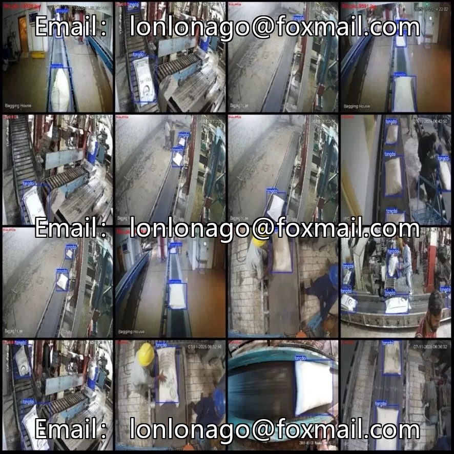
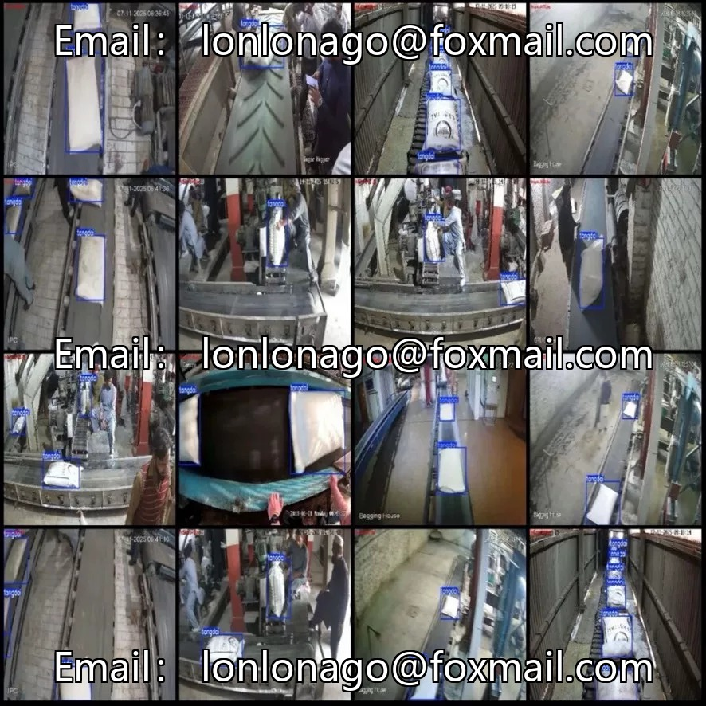

# Industrial sugar bag counting dataset

## Body

Industrial Sugar Bag Counting Dataset - Industrial Sugar Bag Counting Detection Dataset, consisting of 12,943 single-label "tangdai" sugar bags with 29,712 labeled bounding boxes, an average of 2.3 per image, mostly at a resolution of 1920x1080, with good detail retention.
Video frame extraction, continuous scene, suitable for video stream detection and target tracking.
Industrial workshop conveyor belt scene, sugar bags pass in sequence on the conveyor belt, with well-defined poses but possibly stacked, obstructed, or subject to lighting changes.
Large sample size, simple single-class detection task, covering the entire scene.
No training/validation/test split defined; divided according to 8:1:1.
Landing scenario is clear: counting of products on the assembly line, automated quality inspection on packaging lines, production data statistics.

The bag counting can be extended to bags of flour, fertilizers, feed, etc. The algorithm framework is universal and suitable for industrial vision project count module. It is combined with conveyor belt triggering photography to count the production in real time.

Virtual materials, once sold, are non-refundable.
Interested friends, click "I want" to proceed.

## Images

## Payment

Here is a pay link on Stripe ( https://buy.stripe.com/3cs8yP7sY87d0vu9AB ). Please contact me lonlonago@foxmail.com after funding $89, and I will send you a complete data files , thank you!

